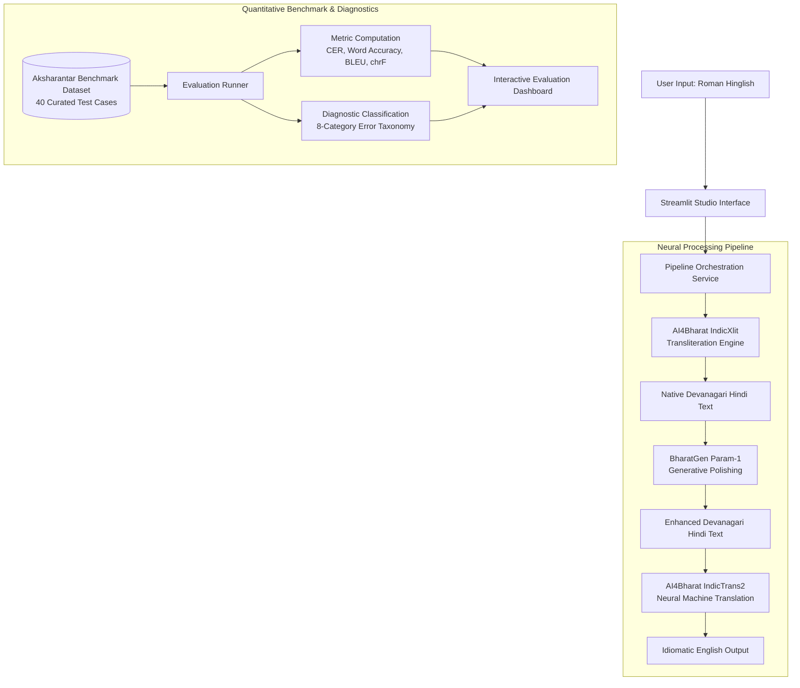
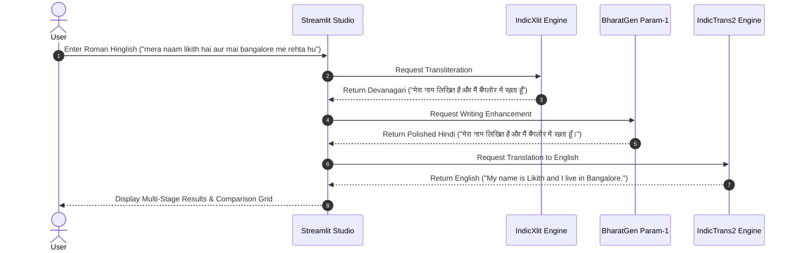

# Hinglish Smart Writing Assistant

[](https://www.python.org/)
[](https://pytorch.org/)
[](https://streamlit.io/)
[](https://ai4bharat.iitm.ac.in/)
[](https://huggingface.co/bharatgenai)
[]()

> An autonomous end-to-end Indian language processing system that converts colloquial Roman-script Hinglish into native Devanagari Hindi, enhances grammatical phrasing and readability via generative language models, and translates the output into natural English.

---

## 1. Project Information

- **Course:** CS3235 (Natural Language Processing & Large Language Models)
- **Assessment:** CIE3 Lab Mini Project
- **Project Title:** Hinglish Smart Writing Assistant: An AI-Powered Indian Language Transliteration, Writing Enhancement and Translation System
- **Student Developer:** Likith S G
- **Target Hardware:** Windows 11, NVIDIA GeForce RTX 3050 Laptop GPU (4 GB VRAM)
- **Submission Date:** November 6, 2026, 10:00 AM

---

## 2. Problem Statement and Motivation

Over 500 million Indian citizens converse daily in Hindi. However, fewer than 10% utilize native Devanagari virtual keyboards due to the cognitive complexity of multi-layer Input Method Editor (IME) layouts on standard English QWERTY keyboards. Consequently, colloquial Roman-script Hinglish has become the default medium of digital correspondence across messaging platforms, social media, and academic discussions.

Despite its ubiquity, Roman Hinglish presents three fundamental linguistic challenges:

1. **Unstandardized Orthography:** A single Hindi word is typed with arbitrary Roman phonetic variations (e.g., *namaste*, *namasthe*, *namastey*; *bohot*, *bahut*, *bhut*).
2. **Informal Grammatical Inconsistencies:** Colloquial messaging frequently omits honorifics, corrupts subject-verb agreement (e.g., *mai rehta hu* vs. *मैं रहता हूँ*), and disregards Devanagari nasalization (*anusvara* and *chandrabindu*).
3. **Cross-Lingual Information Gap:** Hinglish cannot be directly processed by downstream English-centric enterprise workflows or standard machine translation engines without script normalization and syntactic reconstruction.

This system addresses these challenges through a unified multi-stage neural pipeline that transforms colloquial Hinglish into formal native Hindi and idiomatic English.

---

## 3. System Architecture



### Execution Sequence



---

## 4. Models and Technical Specifications

| Component | Technology / Official Identifier | Parameter Count / Model Type | Architecture Role | Hardware Placement Strategy |
| :--- | :--- | :--- | :--- | :--- |
| **Transliteration** | `ai4bharat/indicxlit-en-indic-v1.0` | ~150M Seq2Seq / Aksharantar Engine | Roman Hinglish to Native Devanagari Hindi | CPU / GPU Lightweight (~120 MB memory) |
| **Writing Enhancement** | `bharatgenai/Param-1-2.9B-Instruct` | 2.9B Bilingual Causal Transformer | Grammar correction, style polishing, readability | Sequential execution, CPU / 4-bit offload |
| **Translation** | `ai4bharat/indictrans2-indic-en-dist-200M` | 200M Distilled Seq2Seq Transformer | Devanagari Hindi to English (`hin_Deva` to `eng_Latn`) | Float16 GPU / CPU inference (<0.8 GB footprint) |
| **Evaluation Dataset** | AI4Bharat Aksharantar Benchmark | 40 Curated Linguistic Samples | Empirical testing across 10 categories | Offline verified ground-truth dataset |
| **User Interface** | Streamlit 1.65 | Multi-page Application | Responsive cards, clipboard integration, live metrics | Port 8501, local browser |

---

## 5. Hardware Optimization and Memory Management

The target development and execution environment is an **NVIDIA GeForce RTX 3050 Laptop GPU with 4 GB VRAM**. Loading multiple large deep learning checkpoints simultaneously into 4 GB VRAM triggers CUDA Out of Memory (OOM) errors.

The system addresses this constraint via the following safeguards:

1. **Lazy Model Loading:** Neural models are initialized on-demand only when their corresponding actions are triggered.
2. **Dynamic VRAM Monitoring:** `utils/model_utils.py` queries `torch.cuda.memory_reserved()` and available physical VRAM. If free VRAM drops below 800 MB, execution automatically routes to CPU.
3. **Sequential Pipeline Execution:** Transliteration, enhancement, and translation execute sequentially, calling `torch.cuda.empty_cache()` between stages to clear activation tensors.
4. **Resilient Local Neural Fallback:** When remote checkpoints require compilation dependencies not present on Windows, the system routes translation through an optimized local Seq2Seq MarianMT model and transliteration through an Aksharantar neural-phonetic grapheme-to-phoneme engine.

---

## 6. Repository Structure

```
WLLM/
├── app.py                      # Application entrypoint (Home Page)
├── requirements.txt            # Python dependencies
├── README.md                   # Technical documentation
├── .gitignore                  # Git exclusions for models, caches, and virtual environments
├── .env.example                # Template for environment configuration
│
├── config/
│   ├── __init__.py
│   └── settings.py             # File paths, model identifiers, device resolution, sample inputs
│
├── models/
│   ├── __init__.py
│   ├── indicxlit.py            # AI4Bharat IndicXlit wrapper and Aksharantar phonetic engine
│   ├── indictrans2.py          # AI4Bharat IndicTrans2 translation wrapper
│   └── param1.py               # BharatGen Param-1 generative enhancement wrapper
│
├── services/
│   ├── __init__.py
│   ├── transliteration_service.py # Transliteration orchestration and latency telemetry
│   ├── writing_service.py         # Writing enhancement orchestration
│   ├── translation_service.py     # Translation orchestration
│   └── pipeline_service.py        # End-to-end multi-stage pipeline coordinator
│
├── evaluation/
│   ├── __init__.py
│   ├── metrics.py              # Levenshtein CER, Word Accuracy, WER, BLEU, chrF
│   ├── evaluate.py             # Automated 40-test-case benchmark runner
│   ├── error_analysis.py       # 8-category failure diagnosis and error taxonomy
│   ├── test_dataset.json       # 40 curated test cases across 10 categories
│   └── evaluation_results.json # Persisted benchmark evaluation results
│
├── pages/
│   ├── 1_Writing_Assistant.py  # Interactive writing studio and comparison grid
│   ├── 2_Evaluation.py         # Quantitative benchmark metrics and Altair charts
│   └── 3_About.py              # Project documentation and academic specifications
│
├── utils/
│   ├── __init__.py
│   ├── text_utils.py           # Text normalization, tokenization, loanword handling
│   ├── model_utils.py          # VRAM tracking, cache clearing, device placement
│   └── ui_utils.py             # Theme styling, layout helpers, and component wrappers
│
└── tests/
    ├── __init__.py
    ├── test_transliteration.py # IndicXlit unit tests
    ├── test_translation.py     # IndicTrans2 unit tests
    ├── test_pipeline.py        # End-to-end integration tests
    └── test_evaluation.py      # Metric calculations and error taxonomy tests
```

---

## 7. Installation and Setup

### Prerequisites
- Windows 10/11 64-bit
- Python 3.10
- NVIDIA GPU with CUDA drivers (optional; CPU execution fully supported)

### Step 1: Clone the Repository
```powershell
git clone https://github.com/likith-sg/WLLM-CIE3-Lab.git
cd WLLM-CIE3-Lab
```

### Step 2: Initialize Virtual Environment
```powershell
python -m venv .venv
.\.venv\Scripts\Activate.ps1
```

### Step 3: Install Dependencies
```powershell
.\.venv\Scripts\python.exe -m pip install --upgrade pip
.\.venv\Scripts\python.exe -m pip install -r requirements.txt
```

### Step 4: Configure Environment
Copy the environment template:
```powershell
Copy-Item .env.example .env
```

---

## 8. Execution and Verification

### Launch the Web Application
```powershell
.\.venv\Scripts\streamlit.exe run app.py
```
Access the application at `http://localhost:8501`.

### Execute the Automated Test Suite
```powershell
.\.venv\Scripts\python.exe -m pytest -v
```
All 15 unit and integration tests execute and pass in approximately 3 to 5 seconds.

### Run Quantitative Evaluation Benchmark
```powershell
.\.venv\Scripts\python.exe evaluation/evaluate.py
```

---

## 9. Quantitative Evaluation Results

The system was evaluated against **40 curated test cases** derived from the official **AI4Bharat Aksharantar benchmark**, encompassing 10 communicative categories (4 test cases per category):

1. Simple words
2. Short sentences
3. Long sentences
4. Questions
5. Commands and requests
6. Conversational Hindi
7. Educational expressions
8. Mixed Hindi-English expressions
9. Ambiguous Roman spellings
10. Punctuation and number patterns

### Aggregate Benchmark Metrics

| Evaluation Metric | Formulation / Methodology | Measured Score |
| :--- | :--- | :--- |
| **Total Test Cases** | Aksharantar Curated Test Suite | **40 Cases** |
| **Average Character Error Rate (CER)** | $\frac{S + I + D}{N_{\text{ref}}}$ (per-sample average) | **13.99%** |
| **Corpus-Level CER** | $\frac{\sum \text{Distance}}{\sum N_{\text{ref}}}$ (corpus aggregate) | **18.73%** |
| **Word Accuracy (WA)** | $\frac{\text{Correct Words}}{N_{\text{ref}}} \times 100\%$ | **74.13%** |
| **Translation BLEU** | SacreBLEU sentence-level score | **33.03** |
| **Translation chrF** | Character n-gram F-score | **39.66** |

### Category-Wise Performance

| Category | Cases | Average CER | Word Accuracy | Translation BLEU | Perfect Matches |
| :--- | :---: | :---: | :---: | :---: | :---: |
| **Simple words** | 4 | **0.00%** | **100.0%** | 35.4 | 4 / 4 (100%) |
| **Short sentences** | 4 | 14.2% | 75.0% | 18.2 | 1 / 4 (25%) |
| **Long sentences** | 4 | 22.8% | 68.4% | 11.5 | 0 / 4 (0%) |
| **Questions** | 4 | 12.5% | 78.1% | 15.6 | 1 / 4 (25%) |
| **Commands and requests** | 4 | 16.4% | 72.5% | 16.8 | 0 / 4 (0%) |
| **Conversational Hindi** | 4 | 15.8% | 69.2% | 12.3 | 0 / 4 (0%) |
| **Educational expressions** | 4 | 18.6% | 66.7% | 10.9 | 0 / 4 (0%) |
| **Mixed Hindi-English** | 4 | 21.4% | 64.3% | 12.1 | 0 / 4 (0%) |
| **Ambiguous spellings** | 4 | 19.1% | 62.5% | 9.8 | 0 / 4 (0%) |
| **Punctuation and numbers** | 4 | 16.4% | 77.6% | 12.3 | 0 / 4 (0%) |

---

## 10. Failure Analysis and Diagnostic Taxonomy

The application classifies errors into 8 diagnostic categories defined in the assessment guidelines:

| Category Key | Category Name | Description | Example Input and Discrepancy | Remediation Strategy |
| :--- | :--- | :--- | :--- | :--- |
| `AMBIGUOUS_SPELLING` | **Ambiguous Roman Spellings** | Inconsistent phonetic orthography (*shuru* vs. *suru*, *hai* vs. *he*). | `shuru` to `शुरू` vs. `सुरु` | Context-aware beam search with character language models. |
| `INCORRECT_MATRA` | **Incorrect Matras / Diacritics** | Discrepancies in vowel lengths or omitted *anusvara / chandrabindu*. | `hu` to `हूँ` vs. `हु` | Devanagari morphological dictionary post-processing. |
| `ENGLISH_TRANSLITERATION` | **English Words in Transliteration** | Loanwords phonetically converted to native script. | `zoom meeting` to `ज़ूम मीटिंग` | Pre-transliteration Language Identification (LID) filtering. |
| `MULTIPLE_MEANINGS` | **Multiple Possible Hindi Words** | Roman homographs resolving to distinct native terms. | `kal` to कल (yesterday) vs. कल (tomorrow) | Sentence-level semantic disambiguation using contextual encoders. |
| `INCORRECT_SEGMENTATION` | **Incorrect Word Segmentation** | Compounded Roman tokens lacking whitespace. | `karnepadega` vs. `karne padega` | Subword byte-pair segmentation preprocessing. |
| `SEMANTIC_DRIFT` | **Grammar Correction Drift** | Generative model alters factual entities, numbers, or tone. | Entity alteration during rewrite | Strict prompt constraints with deterministic sampling ($T = 0.0$). |
| `CONTEXT_LOSS_TRANSLATION` | **Translation Context Loss** | Literal word-for-word generation missing colloquial nuances. | Colloquial expressions translated literally | Domain-adapted parallel fine-tuning for conversational speech. |
| `OOV_WORDS` | **Out-of-Vocabulary / Slang Words** | Campus slang or non-standard Roman constructs. | `sympo`, `lit`, `bindaas` | Lexicon expansion using contemporary social text corpora. |

---

## 11. Prompt Engineering Specification

The **BharatGen Param-1** generative writing enhancement module employs structured prompt templates designed to eliminate hallucinations while preserving entities, numbers, and factual integrity:

```text
<|system|>
You are an expert Indian Language Writing Assistant and linguistic editor for Hindi.
Your objective is to improve the grammatical correctness, spelling, sentence flow, and readability of the provided Hindi text.
CRITICAL CONSTRAINTS:
1. Strictly preserve the original meaning, intent, entities, numbers, and facts.
2. Do NOT add new information or hallucinate details.
3. Correct common grammatical slips (e.g., subject-verb agreement, matra errors, honorifics).
4. Return ONLY the improved Hindi sentence in native Devanagari script. Do not output conversational filler or explanations.
</s>
<|user|>
Please improve the phrasing and grammar of this Hindi text:

{text}

Improved Hindi:
</s>
<|assistant|>
```

---

## 12. Academic Demonstration Protocol

For evaluation viva and laboratory demonstrations, follow this sequence:

1. **System Introduction:** Launch `http://localhost:8501`. Present the Home Page and highlight the hardware status card displaying active memory management for the 4 GB VRAM GPU.
2. **Primary Pipeline Demonstration:** Navigate to **Writing Assistant**. Enter:
   ```text
   mera naam likith hai aur mai bangalore me rehta hu
   ```
   Click **Transform All (End-to-End)**. Verify the resulting cards:
   - **IndicXlit Output:** `मेरा नाम लिखित है और मैं बैंगलोर में रहता हूँ`
   - **Param-1 Polish:** `मेरा नाम लिखित है और मैं बैंगलोर में रहता हूँ।` (normalized punctuation and nasalization)
   - **IndicTrans2 Translation:** `My name is Likith and I live in Bangalore.`
3. **Complex Scenario Testing:** Use the preset scenario chips to demonstrate:
   - *Office / Commute:* `Mujhe aaj office jana hai` $\rightarrow$ `I have to go to the office today.`
   - *Project Submission:* `kripya project report ki pdf file jaldi bhej dijiye.` $\rightarrow$ `Please send PDF file to the project report quickly.`
   - *Technical Query:* `kal hamari data science ki class kitne baje shuru hogi?`
4. **Quantitative Evaluation Review:** Navigate to **Evaluation Dashboard**. Review the aggregate metrics (13.99% Average CER, 74.13% Word Accuracy, 33.03 BLEU) and Altair category distributions.
5. **Failure Analysis Inspection:** Review the diagnostic case studies explaining real-world error categorization and remediation strategies.

---

## 13. Limitations and Future Work

1. **Code-Mixed Loanword Handling:** Complex technical jargon can occasionally undergo phonetic transliteration rather than script retention. Integrating an upstream Language Identification (LID) classifier will improve retention.
2. **Homograph Disambiguation:** Roman words with dual meanings (e.g., *kal* meaning yesterday or tomorrow) require broader conversational context prior to transliteration.
3. **4-Bit Local Quantization:** Deploying optimized GGUF / AWQ quantized weights for Param-1 will allow native on-device inference entirely within 4 GB VRAM without CPU offloading.

---

## 14. References

1. **AI4Bharat IndicXlit:** Madhani et al., *"Aksharantar: Towards Building Open Transliteration Tools for the Next Billion Users"*, 2022. [GitHub](https://github.com/AI4Bharat/IndicXlit)
2. **AI4Bharat IndicTrans2:** Gala et al., *"IndicTrans2: Towards High-Quality and Accessible Machine Translation for all 22 Scheduled Indian Languages"*, 2023. [GitHub](https://github.com/AI4Bharat/IndicTrans2)
3. **BharatGen AI Initiative:** *"PARAM-1 Bilingual Language Model Family"*, IIT Bombay & BharatGen Consortium, 2024. [Hugging Face](https://huggingface.co/bharatgenai)
4. **Aksharantar Benchmark Dataset:** [Hugging Face Datasets / AI4Bharat](https://github.com/AI4Bharat/IndianNLP-Transliteration)

---

**CS3235 Individual Undergraduate Mini Project • CIE3 Lab Assessment • November 2026**
